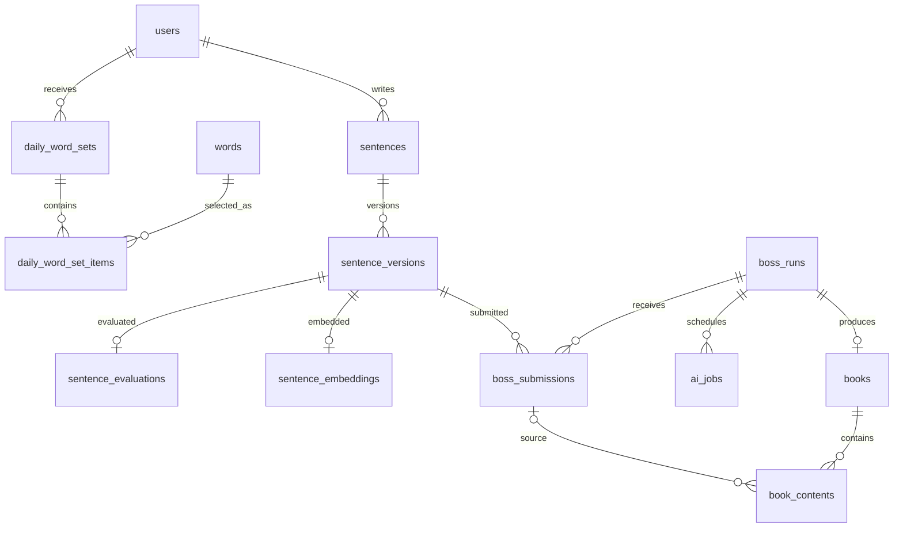

# 잇담 — 다섯 단어로 함께 만드는 이야기

> 매일 주어지는 다섯 단어로 문장을 쓰고, AI 평가를 받아 보스 레이드에 참여합니다.
> 레이드가 끝나면 여러 사람의 문장이 한 권의 공동 책으로 이어지는 창작 게임 서비스입니다.


## 왜 만들었나

빈 화면 앞에서 첫 문장을 시작하는 일은 어렵습니다. 잇담은 다섯 단어라는 작은 제약과 공동 목표를 연결해 글쓰기의 시작을 돕습니다. 혼자 작성한 문장이 평가와 레이드를 거쳐 공동 책의 일부가 되도록 구성했습니다.

1. 오늘의 단어를 확인하고 나만의 문장을 작성합니다.
2. AI 평가 결과를 확인하고 보스 레이드에 문장을 제출합니다.
3. 함께 완성한 책을 도서관에서 읽고 내 서고에 창작 기록을 쌓습니다.

| 구분        | 내용                                                               |
| ----------- | ------------------------------------------------------------------ |
| 서비스 유형 | AI 문장 평가와 협동 레이드를 결합한 창작 게임                      |
| 아키텍처    | React SPA + Spring Boot API + FastAPI AI Service                   |
| 핵심 기능   | 오늘의 단어, 문장 작성·평가, 보스 레이드, 공동 책, 도서관, 내 서고 |
| 인프라      | PostgreSQL·pgvector, Redis, RabbitMQ, Docker, Jenkins              |
| 배포 구성   | 단일 EC2, nginx, 백엔드 A/B 슬롯 순차 교체                         |

## 기술 스택

### Frontend

| 구분           | 기술                               |
| -------------- | ---------------------------------- |
| 화면·언어      | React 19, TypeScript               |
| 빌드·라우팅    | Vite, React Router                 |
| 서버 상태·통신 | TanStack Query, Axios              |
| 입력·검증      | React Hook Form, Zod               |
| 스타일         | Tailwind CSS v4                    |
| 테스트         | Vitest, React Testing Library, MSW |

### Backend · AI · Infra

| 구분             | 기술                                                         |
| ---------------- | ------------------------------------------------------------ |
| API              | Java 21, Spring Boot 4.0.7, MVC, JPA, Security, AMQP         |
| 스키마           | PostgreSQL, Flyway V1~V16, Hibernate validate                |
| AI 서비스        | Python 3.12, FastAPI, GMS를 통한 Gemini 호출, aio-pika       |
| 임베딩           | 768차원 임베딩, pgvector 코사인 유사도                       |
| 실시간·공유 상태 | SSE, Redis pub/sub, ZSET, Spring Session                     |
| 비동기 작업      | RabbitMQ, 발행 릴레이, DLQ                                   |
| 배포·관측        | Docker Compose, nginx, Jenkins, Loki·Alloy·Grafana, ShedLock |

## A. 문서 범위

이 문서는 공개 저장소의 서비스 흐름과 프론트엔드·백엔드·AI 연동을 함께 설명합니다. 런타임 계약은 코드와 Swagger, DB 스키마는 Flyway 마이그레이션을 기준으로 확인합니다. 상세 자료는 [프로젝트 레퍼런스](docs/README.md)에 있습니다.

개인 기여는 팀장 및 홈·튜토리얼·문장 작성·도서관·내 서고·보스 레이드 등 프론트엔드 주요 화면 구현입니다. 아래 서버·AI·인프라 설명은 **팀 서비스 전체의 구조**이며 개인 담당 범위와 구분합니다.

## B. 목표 서비스 및 구현 정도

### 목표 사용자 흐름

```text
홈 → 회원가입·로그인 → 오늘의 단어 확인 → 문장 작성·저장
    → AI 평가 → 내 서고 → 보스 레이드 제출
    → 레이드 클리어 → 공동 책 생성 → 도서관에서 읽기
```

### 구현 상태

| 영역           | 저장소에서 확인되는 상태                              |
| -------------- | ----------------------------------------------------- |
| 인증           | 이메일 인증, 세션 로그인, 소셜 로그인, CSRF 처리 구현 |
| 문장 작성      | 생성·수정·버전 관리, 평가 결과 및 개인 서고 연동      |
| 문장 평가      | HTTP 호출 및 RabbitMQ 기반 비동기 처리 경로 구현      |
| 레이드         | 제출·HP·리더보드 및 SSE 갱신 구현                     |
| 공동 책        | 생성 작업 발행·결과 수신·출처 검증 구현               |
| 도서관         | 책 목록·상세·읽기 화면 구현                           |
| 로컬 외부 연동 | Fake/Logging·인메모리 구현을 기본값으로 제공          |
| 배포           | Jenkins·A/B 슬롯·Redis 세션 공유 구성 포함            |

실제 외부 서비스 연동 여부는 실행 프로필과 환경변수에 따라 달라집니다. 배포 설정이 저장소에 있다는 사실과 현재 서비스의 접속 가능 여부는 별도로 확인해야 합니다.

## C. 데이터베이스 모델링 ERD

아래는 핵심 관계를 추린 개요입니다. 전체 30개 테이블과 제약조건은 [운영 스키마 DBML](docs/implementation/itdam-erd.dbml), 스키마 변경의 기준은 [Flyway 마이그레이션](backend/src/main/resources/db/migration/)입니다.



### 모델링 특징

- 문장과 문장 버전을 분리해 평가·제출이 참조하는 내용을 고정합니다.
- 평가 결과와 임베딩을 문장 버전에 연결합니다.
- 레이드 실행 회차, 제출 기록, AI 생성 작업을 분리해 진행과 실패를 추적합니다.
- 책 본문 블록에 원본 제출 문장과 작성자 참조를 남겨 출처를 보존합니다.

## D. 문장 평가 및 공동 책 생성 흐름

### 문장 평가

1. Spring이 문장 평가 요청을 접수합니다.
2. 배포 구성에서는 RabbitMQ로 작업을 발행하고 FastAPI가 평가합니다.
3. 결과를 수신해 상태를 갱신하고 프론트엔드는 폴링으로 결과를 확인합니다.
4. 평가 성공 시 생성한 임베딩은 유사 문장 재제출 검사에 사용합니다.

유사도 검사는 동일 사용자·동일 레이드 회차의 이전 제출을 비교하며, 현재 문서의 차단 기준은 코사인 유사도 `0.70`입니다.

### 공동 책 생성

레이드 클리어 → 생성 잡 저장·발행 릴레이 → RabbitMQ 실행 지시 → AI Service의 읽기 전용 DB 조회 → 본문 생성·계약 검증 → 결과 큐 → Spring 저장 순서입니다.

본문은 `USER_ORIGINAL`, `USER_EDITED`, `AI_GENERATED`로 구분합니다. 사용·제외 제출 ID는 반환된 블록을 바탕으로 계산하고, 원문 보존 규칙을 검증합니다. 자세한 계약은 [AI Service 문서](ai-service/README.md)를 참고합니다.

## E. 핵심 기능

### 1. 인증과 공통 API

서버 세션(`HttpSession`, `JSESSIONID`)으로 인증합니다. 변경 요청 전 `GET /api/v1/csrf`로 토큰을 받고 `X-XSRF-TOKEN` 헤더에 전달합니다. 로그인 성공 후에는 토큰을 다시 발급받습니다.

### 2. 문장 작성과 내 서고

오늘의 단어를 사용해 문장을 작성하고 저장·평가·제출 상태를 확인합니다. `/workshop`의 이전 주소는 `/sentences/new`로 연결해 기존 링크를 유지합니다.

### 3. 보스 레이드와 실시간 갱신

평가된 문장을 레이드에 제출하고 HP·리더보드를 SSE로 받습니다. 배포 환경에서는 Redis pub/sub로 여러 백엔드 인스턴스에 이벤트를 전달합니다.

### 4. 공동 책과 도서관

클리어된 레이드의 문장으로 공동 책을 생성합니다. 목록·상세·읽기 화면을 통해 함께 만든 결과를 탐색합니다.

### 5. 운영과 장애 대응

평가와 책 생성의 실패 상태, 재시도, DLQ, 발행 릴레이를 둡니다. 배포 시에는 Redis로 세션을 공유하고 ShedLock으로 주기 작업의 중복 실행을 제어합니다.

## F. 생성형 AI 활용

### 서비스 기능에서의 AI

| 활용         | 역할                                       |
| ------------ | ------------------------------------------ |
| 문장 평가    | 단어 사용 여부와 평가 결과를 구조화해 반환 |
| 문장 임베딩  | 이전 제출과의 유사도 계산에 사용           |
| 공동 책 생성 | 선별된 문장을 연결하고 블록별 출처를 표시  |

외부 LLM이 설정되지 않아도 AI 서버는 기동할 수 있지만, 유효한 평가 요청에는 `503 LLM_NOT_CONFIGURED`를 반환합니다. 서버 기동과 실제 AI 평가 성공을 구분합니다.

### 개발 과정에서의 AI

개발 도구로 AI를 사용한 구체적인 범위는 이 README에서 확정하지 않습니다. 서비스에 포함된 AI 처리와 개발 보조 도구 사용 이력은 별개의 내용입니다.

## G. 실행 방법

### 사전 요구 사항

| 항목       | 기준                          |
| ---------- | ----------------------------- |
| Backend    | Java 21, Gradle Wrapper       |
| Frontend   | Node.js 24.18.0, pnpm 11.17.0 |
| AI Service | Python 3.12                   |
| Infra      | Docker Desktop                |

### 1. 인프라와 백엔드

저장소 루트에서 PowerShell로 실행합니다.

```powershell
Copy-Item infra/.env.example infra/.env
docker compose --env-file infra/.env -f infra/compose.yml up -d
cd backend
.\gradlew.bat bootRun --args='--spring.profiles.active=local'
```

헬스 체크는 `/actuator/health`, API 문서는 `/swagger-ui.html`입니다. 상세 설정은 [인프라 문서](infra/README.md)를 참고합니다.

### 2. 프론트엔드

새 터미널을 열고 저장소 루트에서 실행합니다.

```powershell
cd frontend
corepack pnpm install --frozen-lockfile
Copy-Item .env.example .env
corepack pnpm dev
```

```dotenv
VITE_API_BASE_URL=http://localhost:8080/api
VITE_ENABLE_MSW=false
```

접속 주소는 `http://localhost:5173`입니다. 요청 경로에는 `/v1/...`을 사용해 `/api`가 중복되지 않게 합니다.

### 3. AI Service

별도 터미널에서 실행합니다. 실제 모델 호출에는 예시 파일의 LLM 설정을 채워야 합니다.

```powershell
cd ai-service
python -m venv .venv
.\.venv\Scripts\Activate.ps1
python -m pip install -r requirements.txt
Copy-Item .env.example .env
python -m uvicorn main:app --reload --port 8001
```

헬스 체크는 `http://localhost:8001/health`, OpenAPI UI는 `http://localhost:8001/docs`입니다. RabbitMQ 컨슈머는 별도 스위치와 브로커 설정이 필요합니다.

### 주요 API 엔드포인트

아래 업무 경로의 기본 접두사는 `/api/v1`입니다.

| 도메인         | 엔드포인트 계열                                                          |
| -------------- | ------------------------------------------------------------------------ |
| 계정·인증      | `/users`, `/auth/sessions`, `/users/me`, `/csrf`, `/email-verifications` |
| 오늘의 단어    | `/daily-words/today`                                                     |
| 문장·평가      | `/sentences`, `/sentence-versions/*`, `/evaluation-usage/today`          |
| 내 서고        | `/me/sentences`                                                          |
| 보스 레이드    | `/boss-runs`                                                             |
| 책 생성·도서관 | `/ai-jobs`, `/boss-runs/{id}/book-generation`, `/library/books`          |

소셜 로그인은 `GET /api/oauth2/authorization/{kakao|naver|google}`로 진입합니다. 상세 요청·응답은 실행 중인 Swagger를 기준으로 확인합니다.

## H. 기타 기록

### 저장소 구조

```text
.
├─ frontend/       # React 화면·feature별 API·테스트
├─ backend/        # Spring API·도메인·Flyway 마이그레이션
├─ ai-service/     # 평가·책 생성·임베딩·MQ 컨슈머
├─ infra/          # DB·Redis·RabbitMQ·관측 스택
├─ docs/           # 레퍼런스·ERD·운영 문서
├─ exec/           # 포팅 매뉴얼·배포 런북
├─ scripts/
└─ Jenkinsfile*    # 영역별 배포 파이프라인
```

### 테스트

| 위치          | 명령                                                               | 범위                                      |
| ------------- | ------------------------------------------------------------------ | ----------------------------------------- |
| `backend/`    | `.\gradlew.bat test`                                               | 단위·JPA·E2E, H2 사용                     |
| `backend/`    | `.\gradlew.bat infraTest`                                          | Docker 기반 PostgreSQL·RabbitMQ·계약 검증 |
| `frontend/`   | `corepack pnpm typecheck`, `lint`, `test`, `build`, `format:check` | 타입·정적 검사·화면 테스트·빌드·포맷      |
| `ai-service/` | `python -m pytest`                                                 | AI Service 테스트; 개발 의존성 설치 필요  |

Spring↔FastAPI 계약 컨테이너 검증에는 `AI_CONTRACT_TEST_IMAGE` 설정이 필요합니다. 명령은 실행 안내이며, 이 README 편집 과정에서 전체 앱 테스트를 실행했다는 뜻은 아닙니다.

### 트러블슈팅과 설계에서 확인한 점

| 상황                                          | 대응                                       |
| --------------------------------------------- | ------------------------------------------ |
| 평가 지연이 API 요청을 오래 점유              | 접수·발행·폴링을 나누는 비동기 경로        |
| 생성 결과가 원문이나 사용 문장 수를 잘못 보고 | 본문 블록과 원본 제출 ID를 직접 검증       |
| 인스턴스마다 로그인·이벤트 상태가 달라짐      | Redis 세션 공유와 pub/sub 팬아웃           |
| 프론트엔드 요청이 `/api/api/...`가 됨         | 기본 URL의 `/api`와 업무 경로의 `/v1` 분리 |

초기 자동 저장 개선 사례와 현재 수동 저장 화면은 [개인 포트폴리오](https://github.com/JJ-Yurim/Portfolio)에서 구분해 설명합니다. 과거 구현 사례를 현재 동작으로 혼동하지 않는 것이 문서 유지의 기준입니다.

### 개선 방향과 참고 문서

- 프론트엔드 하위 README에 남은 초기 골격 설명은 현재 라우터·feature 구현과 함께 확인합니다.
- 로컬 Fake/Logging 결과와 외부 AI·MQ·배포 검증 결과를 구분해 기록합니다.
- 배포 절차는 [포팅 매뉴얼](exec/01-포팅-매뉴얼.md), 장애 진단은 [운영 문서](docs/operations/)를 참고합니다.
